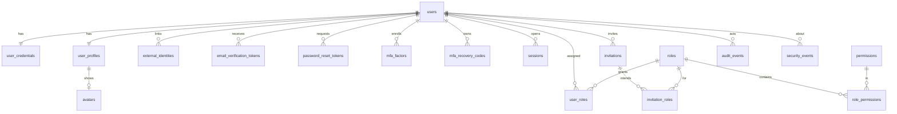

# 07 — Data Model / ERD (Phase 3)

> **Update (ADR-013):** the backend is now **ASP.NET Core (.NET)**, not Next.js/TypeScript. Where this document mentions Next.js route handlers, Server Actions, Drizzle, zod or Vercel for the API, read the equivalent in `13-adr-dotnet-backend.md`. Design intent (layers, schema, contracts, security controls) is unchanged.

Status: **proposed — awaiting PO approval.** PostgreSQL 16 + Drizzle. Single-tenant (D-06): there is deliberately **no `org_id`**. Names are `snake_case`; PKs are `uuid` (v7 where ordering helps) unless noted; all timestamps `timestamptz` (UTC).

> **Implementation notes (slice 1):** implemented as EF Core 10 migrations (`api/src/AnnabaDigital.Infrastructure/Persistence/Migrations`). `citext` → `text` + `CHECK (email = lower(email))` + unique index; `inet` → `text`; token/session hashes are SHA-256 **hex text**; enums stored as strings; append-only `audit_events` is enforced by **DB triggers** (UPDATE/DELETE/TRUNCATE rejected; retention purge only inside `SET LOCAL annabadigital.allow_audit_purge = 'on'`). Tables for later slices (invitations, MFA, tokens, avatars, external identities) already exist but have no endpoints yet.

## 1. ERD


## 2. Tables
Legend: **PK**, **FK**, `UQ` unique, `IDX` index, `CK` check.

### 2.1 Identity
**users**
| column | type | notes |
|---|---|---|
| id | uuid PK | |
| email | citext NOT NULL | `UQ` (case-insensitive) |
| name | text NOT NULL | `CK length(trim(name)) >= 2` |
| status | user_status NOT NULL default `pending` | enum below |
| email_verified_at | timestamptz null | null ⇒ unverified |
| failed_login_count | int NOT NULL default 0 | reset on success |
| locked_until | timestamptz null | temporary lock (status stays `active`; `locked` is derived when `locked_until > now()`) |
| last_login_at | timestamptz null | |
| created_at / updated_at | timestamptz | |
| deactivated_at | timestamptz null | |
| version | int NOT NULL default 1 | optimistic concurrency |
IDX: `(status)`, `(created_at desc)`, `(lower(name) text_pattern_ops)` for search, `(last_login_at)`.

**user_credentials** — `user_id` PK/FK, `password_hash` text NOT NULL (Argon2id PHC string incl. params), `password_changed_at`, `must_change` bool. Separate table so ordinary user queries never load hashes.

**user_profiles** — `user_id` PK/FK, `phone`, `department`, `job_title`, `language` (`en|id`), `timezone`, `notify_email`, `notify_security`, `notify_product` (bool), `auto_lock_minutes` int, `avatar_id` FK → avatars null.

**avatars** — `id`, `user_id` UQ FK, `content_type` CK in (png,jpeg,webp), `bytes` bytea CK `octet_length <= 262144`, `created_at`. (Adapter allows swap to S3/Blob later — D-11.)

**external_identities** *(extension point)* — `id`, `user_id` FK, `provider`, `subject`, `created_at`; `UQ(provider, subject)`.

### 2.2 Tokens & MFA
All token tables store **only `token_hash` (SHA-256 of a 256-bit random token)**; the raw token exists only in the email link.

**email_verification_tokens** — `id`, `user_id` FK, `new_email` citext null (set for email-change), `token_hash` UQ, `expires_at`, `consumed_at`, `created_at`. IDX `(user_id, created_at desc)`. Creating a new token invalidates (`consumed_at=now()`) earlier unconsumed ones.

**password_reset_tokens** — `id`, `user_id` FK, `token_hash` UQ, `expires_at` (30 min), `consumed_at`, `request_ip` inet, `created_at`. Single-use: consumption is `UPDATE … SET consumed_at=now() WHERE token_hash=$1 AND consumed_at IS NULL AND expires_at>now() RETURNING user_id` (atomic).

**mfa_factors** — `id`, `user_id` FK, `type` (`totp` | future `webauthn`), `secret_ciphertext` bytea, `secret_nonce` bytea, `key_version` int, `confirmed_at` null (null while enrolling), `last_used_step` bigint (replay protection), `created_at`. `UQ(user_id, type)`. Secret encrypted with AES-256-GCM using `ENCRYPTION_KEY[key_version]`.

**mfa_recovery_codes** — `id`, `user_id` FK, `code_hash` (Argon2id or SHA-256 of high-entropy code), `used_at`, `created_at`. 10 per set; regenerate = delete all + insert new in one transaction.

### 2.3 RBAC
**permissions** — `key` text PK (`resource.action`, `CK key ~ '^[a-z_]+\.[a-z_]+$'`), `module`, `description`, `is_critical` bool. **Seeded from code** (single source of truth); not editable at runtime.

**roles** — `id` uuid PK, `key` text `UQ` (stable id like `super_admin`), `name` text, `description`, `is_system` bool, `is_protected` bool, `archived_at` null, timestamps. `UQ(lower(name)) WHERE archived_at IS NULL`.

**role_permissions** — `role_id` FK, `permission_key` FK, `granted_by` FK users, `granted_at`; PK `(role_id, permission_key)`.

**user_roles** — `user_id` FK, `role_id` FK, `assigned_by` FK, `assigned_at`; PK `(user_id, role_id)`. IDX `(role_id)`.

Effective permissions for a user:
```sql
SELECT DISTINCT rp.permission_key
FROM user_roles ur
JOIN roles r ON r.id = ur.role_id AND r.archived_at IS NULL
JOIN role_permissions rp ON rp.role_id = r.id
JOIN users u ON u.id = ur.user_id AND u.status = 'active'
WHERE ur.user_id = $1;
```

### 2.4 Sessions & invitations
**sessions** — `id` uuid PK, `token_hash` bytea `UQ` (hash of 256-bit random id; raw value only in the cookie), `user_id` FK, `created_at`, `last_active_at`, `idle_expires_at`, `absolute_expires_at`, `revoked_at`, `revoked_reason` (`user|admin|password_reset|suspended|expired`), `locked_at` null (**server-side lock**), `mfa_verified_at`, `reauth_at` (for sensitive actions), `ip` inet, `user_agent` text, `device_label`, `browser_label`. IDX `(user_id) WHERE revoked_at IS NULL`, `(absolute_expires_at)`.
A session is **valid** iff `revoked_at IS NULL AND now() < idle_expires_at AND now() < absolute_expires_at`; **usable** additionally requires `locked_at IS NULL` and user `active`.

**invitations** — `id`, `email` citext, `token_hash` UQ, `invited_by` FK, `message` text null, `status` (`pending|accepted|revoked`; *expired* is derived from `expires_at`), `expires_at`, `accepted_at`, `accepted_user_id` FK null, `revoked_at`, `created_at`. **Partial unique** `UQ(email) WHERE status='pending'` (one open invitation per address). **invitation_roles** — `(invitation_id, role_id)` PK.

### 2.5 Monitoring & settings
**audit_events** — `id` bigserial PK, `ts` timestamptz default now(), `actor_id` FK null (system/anonymous), `actor_label` text (snapshot name/email for deleted/anonymous actors), `action` text, `target_type`, `target_id`, `outcome` (`success|failure|denied`), `ip` inet, `user_agent`, `request_id`, `meta` jsonb (redacted), `diff` jsonb (safe before/after). IDX `(ts desc)`, `(actor_id, ts desc)`, `(action, ts desc)`, `(target_type, target_id)`. **Append-only**: the application DB role has `INSERT, SELECT` only; purge runs under a separate maintenance role.

**security_events** — `id`, `ts`, `type`, `severity` (`low|medium|high`), `user_id` FK null, `detail` text, `meta` jsonb, `acknowledged_by` FK null, `acknowledged_at`. IDX `(ts desc)`, `(acknowledged_at) WHERE acknowledged_at IS NULL`, `(user_id, ts desc)`.

**system_settings** — `key` text PK, `value` jsonb, `is_secret` bool, `value_ciphertext` bytea null (for secrets; `value` null), `key_version`, `updated_by` FK, `updated_at`, `version`. Secrets are never selected by read endpoints (API returns `{set: true}` only).

**rate_limit_buckets** — `key` text PK (`scope:ip:…` / `scope:acct:…`), `count` int, `window_start` timestamptz, `blocked_until` timestamptz null. Cleanup by cron.

*(P2)* `daily_auth_stats(date PK, success int, failure int)` rollup for the dashboard if audit volume makes live aggregation slow.

## 3. Enums & state machines
```
user_status:  pending ──verify──▶ active ◀──activate── suspended
                │                   │ ▲                   ▲
                │                   │ └──activate── deactivated
                └──(admin) deactivate/suspend──────────────┘
 active ──suspend──▶ suspended ──deactivate──▶ deactivated        (temp lock = locked_until, not a status)
invitation:   pending ──accept──▶ accepted
              pending ──revoke──▶ revoked        pending ──(time)──▶ expired(derived)
              resend: pending/expired/revoked ──▶ pending (new token_hash, new expiry)
session:      active ──lock──▶ locked ──unlock──▶ active
              active|locked ──revoke/expire──▶ ended
```
Transitions are enforced in `domain` (table of allowed moves) and re-validated in the use-case transaction.

## 4. Integrity rules beyond FKs
| Rule | Mechanism |
|---|---|
| ≥ 1 active Super Admin always | use-case check under `FOR UPDATE` **plus** a deferred constraint trigger on `user_roles`/`users` as a backstop |
| Protected roles' permissions immutable | domain policy + trigger rejecting `role_permissions` changes where `roles.is_protected` |
| Cannot grant a permission you lack | use-case (`grantableRoles`, matrix-save check); audited as `denied` |
| One pending invitation per email | partial unique index |
| Token single use | atomic `UPDATE … RETURNING` |
| MFA TOTP replay | `last_used_step` must increase |
| Email uniqueness incl. pending email change | change confirmed only if address still unused at confirmation time |
| Audit immutability | DB grants (no UPDATE/DELETE for app role) |

## 5. Seed data (migration `0002_seed`)
Permission catalog (17 keys, see RBAC matrix) · roles `super_admin` (protected, all permissions), `user_admin`, `security_auditor`, `user` · default `system_settings` (invitation-only, 12-char min, idle 30 min, absolute 12 h, lockout 5/15 min, MFA optional, invitations 7 d, audit retention 365 d) · **no default users**. First Super Admin is created by `npm run bootstrap:admin` (reads email from env, emails a one-time setup link — never a default password).

## 6. Retention & cleanup (cron, daily)
Delete consumed/expired tokens older than 7 days · delete revoked/expired sessions older than 30 days · purge `audit_events`/`security_events` older than `auditRetentionDays` (maintenance role, itself audited) · prune `rate_limit_buckets`.

## 7. Sizing & performance notes
10k users / 1M audit rows: all list endpoints are keyset- or offset-paginated on indexed columns; search uses trigram index (`pg_trgm`) on `name`/`email` if `ILIKE '%x%'` is required (decision with the users-list implementation). Dashboard aggregates use indexed counts; heavy login-activity charts use `daily_auth_stats` if p95 > 300 ms.
