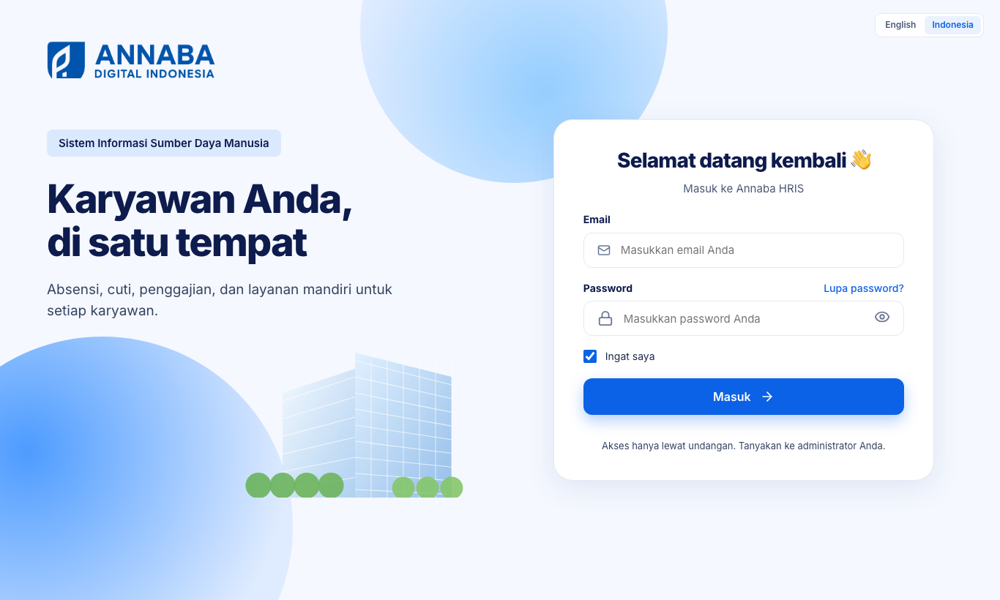
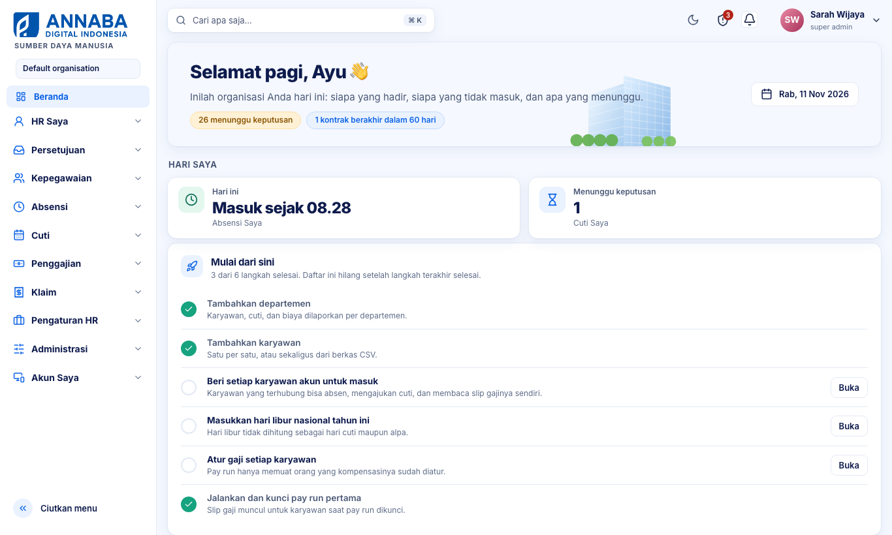
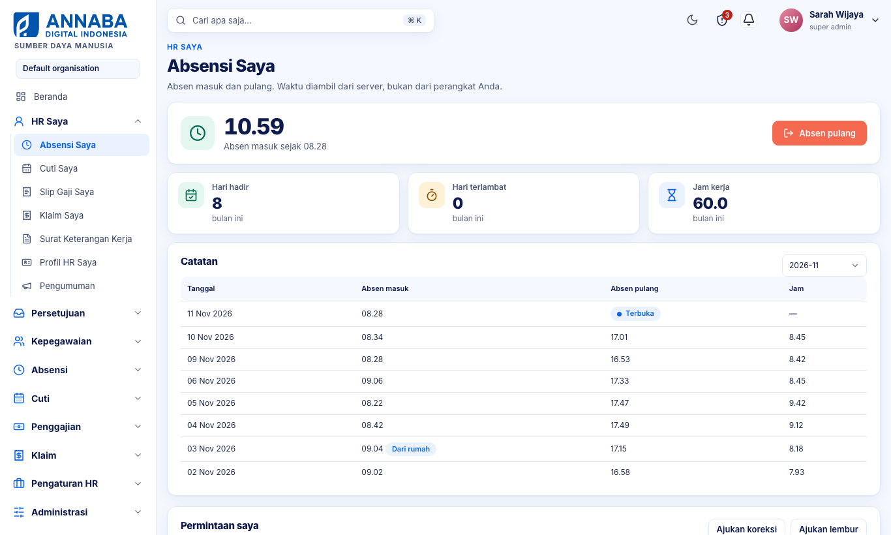
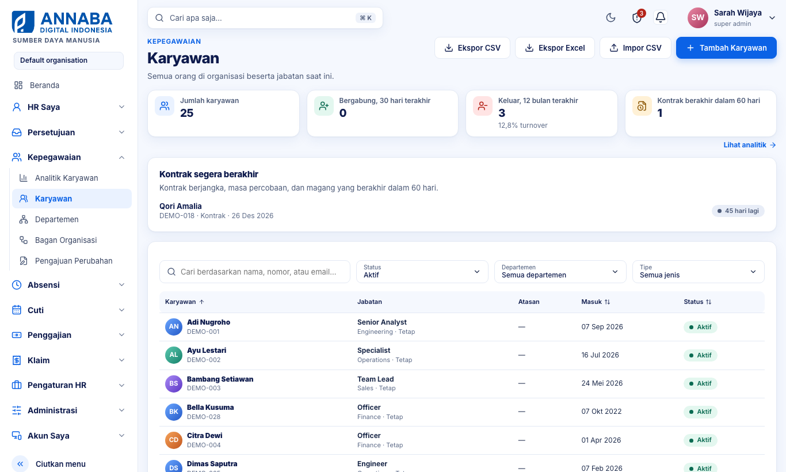
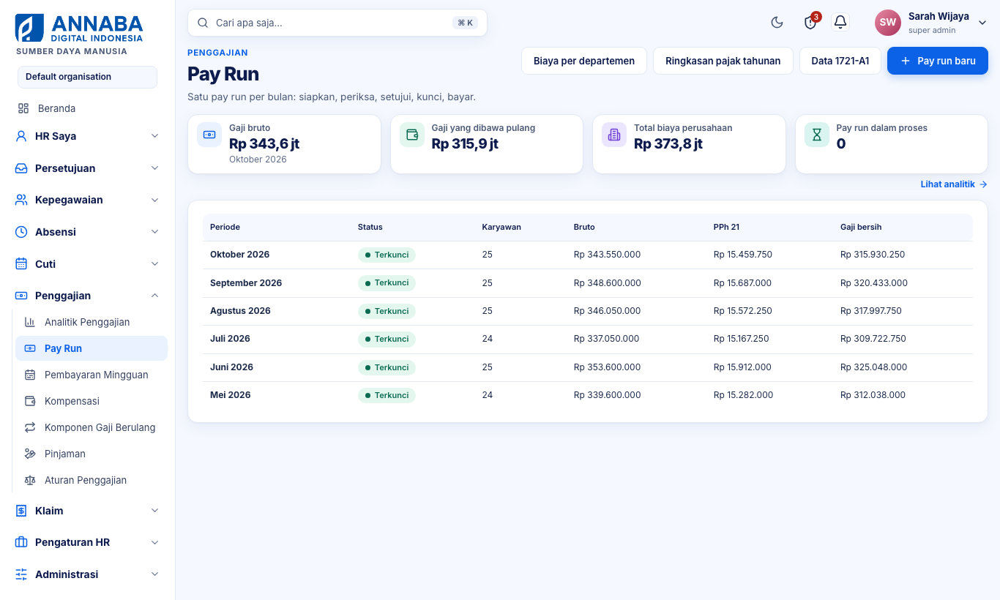
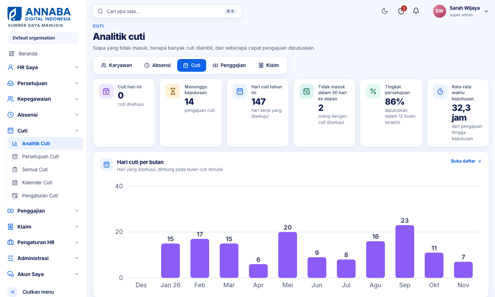
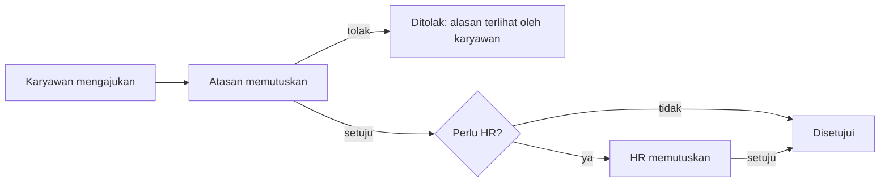
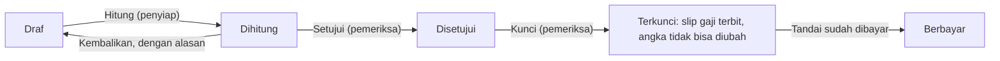

# 36 — Panduan Pengguna Annaba HRIS

Diperbarui 11 November 2026. Versi yang bisa dibagikan dan dikomentari: https://claude.ai/artifact/CgUqjkVgrAmgPCNCyRJckt. Ringkasan singkat per peran ada di `30-hr-user-guide.md`; dokumen ini adalah manual lengkapnya.

## 1. Tentang Annaba HRIS

Annaba HRIS adalah satu tempat untuk seluruh urusan kepegawaian: data karyawan, absensi, cuti, penggajian, klaim pengeluaran, dan layanan mandiri karyawan. Alamatnya `https://hris.annabadigital.io` dan dibuka lewat peramban di komputer maupun ponsel.

Tiga hal yang membedakannya dari lembar kerja atau formulir kertas:

- **Satu sumber data.** Absensi, cuti, dan klaim yang disetujui langsung masuk ke penggajian bulan itu. Tidak ada salin-tempel antarberkas.
- **Setiap pengajuan punya jejak.** Siapa mengajukan, siapa memutuskan, kapan, dan dengan alasan apa tersimpan dan bisa dilihat kembali.
- **Setiap orang hanya melihat bagiannya.** Menu menyesuaikan peran: karyawan melihat datanya sendiri, atasan melihat timnya, HR dan payroll melihat sesuai tugasnya.

### Siapa memakai apa

| Peran | Yang dikerjakan di sini | Manfaatnya |
| --- | --- | --- |
| Karyawan | Absen, ajukan cuti dan klaim, lihat slip gaji, minta surat keterangan kerja, perbarui data diri | Tidak perlu bertanya ke HR untuk saldo cuti, slip, atau status pengajuan |
| Atasan | Menyetujui cuti, koreksi absen, lembur, dan klaim tim; melihat siapa yang hadir hari ini | Semua pengajuan tim ada di satu kotak masuk |
| HR | Mengelola data karyawan, departemen, shift, jenis cuti, hari libur, pengumuman | Data rapi, riwayat jabatan tersimpan, laporan siap pakai |
| Payroll | Mengatur gaji, menjalankan pay run bulanan, mengunduh file bank dan laporan pajak | Perhitungan PPh 21 dan BPJS otomatis, dengan pemeriksaan oleh orang kedua |
| Administrator | Mengundang pengguna, mengatur peran, memantau audit dan keamanan | Akses terkendali dan dapat diaudit |

Satu orang bisa memegang lebih dari satu peran. Seorang atasan, misalnya, tetap memakai bagian karyawan untuk urusannya sendiri.

### Cara membaca panduan ini

Nama menu dan tombol ditulis **tebal**, persis seperti di layar berbahasa Indonesia. Tanda panah berarti urutan klik: **HR Saya → Cuti Saya** artinya buka grup HR Saya, lalu pilih Cuti Saya. Bab 2 dan 3 untuk semua orang; bab berikutnya cukup dibaca sesuai peran Anda.

## 2. Memulai

Akun dibuat lewat undangan, bukan pendaftaran sendiri. Anda menerima e-mail undangan, membuat kata sandi sendiri, lalu masuk.

### Masuk pertama kali

1. Buka e-mail undangan dan klik tautannya. Tautan berlaku 7 hari dan hanya bisa dipakai sekali.
2. Buat kata sandi: minimal 12 karakter, dengan huruf besar, huruf kecil, angka, dan simbol.
3. Masuk di `https://hris.annabadigital.io` dengan e-mail dan kata sandi itu.
4. Aktifkan verifikasi dua langkah (MFA): **Akun Saya → Profil Saya → Keamanan → Aktifkan MFA**. Pindai kode QR dengan aplikasi autentikator, lalu simpan kode pemulihan yang ditampilkan. Akun HR, payroll, dan administrator sebaiknya selalu memakai MFA.

*Halaman masuk. Pilihan bahasa ada di kanan atas.*

Lupa kata sandi: klik **Lupa password?** di halaman masuk. Tautan penggantinya berlaku 30 menit.

### Susunan menu

Menu di sisi kiri mengikuti urutan pekerjaan. Anda hanya melihat grup yang boleh Anda buka.

| Grup menu | Isinya | Siapa yang melihat |
| --- | --- | --- |
| **Beranda** | Ringkasan hari ini | Semua |
| **HR Saya** | Absensi, cuti, slip gaji, klaim, surat, profil, dan pengumuman milik sendiri | Semua |
| **Persetujuan** | Kotak Persetujuan, Tim Saya, Delegasi Persetujuan | Atasan dan HR |
| **Kepegawaian** | Analitik Karyawan, Karyawan, Departemen, Bagan Organisasi, Pengajuan Perubahan | HR |
| **Absensi** | Analitik Absensi, Laporan Absensi, Persetujuan Waktu Kerja, Shift, Lokasi Kerja | HR |
| **Cuti** | Analitik Cuti, Persetujuan Cuti, Semua Cuti, Kalender Cuti, Pengaturan Cuti | HR dan atasan |
| **Penggajian** | Analitik Penggajian, Pay Run, Pembayaran Mingguan, Kompensasi, Komponen Gaji Berulang, Pinjaman, Aturan Penggajian | Payroll |
| **Klaim** | Analitik Klaim, Klaim Pengeluaran | HR dan payroll |
| **Pengaturan HR** | Perusahaan, Alur Persetujuan, Webhook, Cek Kesiapan Go-Live | HR dan administrator |
| **Administrasi** | Pengguna, peran dan izin, log audit, keamanan, pengaturan sistem | Administrator |
| **Akun Saya** | Profil Saya, Sesi & Perangkat, Permintaan Akses, Pengaturan | Semua |

Di atas setiap judul halaman tertulis nama grupnya, sehingga Anda selalu tahu sedang berada di modul mana.

### Beranda

Beranda adalah halaman pertama setelah masuk.

*Beranda seorang pengguna HR: Hari saya di atas, lalu daftar Mulai dari sini. Gambar di panduan ini memakai data contoh.*

- **Hari saya** tampil untuk setiap karyawan: status absen hari ini, sisa cuti, dan jumlah pengajuan Anda yang menunggu keputusan. Di bawahnya ada tugas yang harus Anda selesaikan, pengumuman, dan yang akan datang (cuti, hari libur, slip gaji terbaru).
- **Organisasi hari ini** tampil untuk yang bekerja di HR: jumlah karyawan, yang hadir, yang cuti, yang menunggu keputusan, grafik kehadiran 30 hari, dan daftar hal yang perlu perhatian.
- **Mulai dari sini** tampil selama organisasi belum selesai disiapkan (lihat bab 8).

### Bagian atas layar

- **Kotak cari** (atau tekan Ctrl+K / ⌘K): ketik nama halaman untuk langsung membukanya.
- **Ikon bulan**: beralih antara tampilan terang dan gelap.
- **Lonceng**: notifikasi untuk Anda, misalnya pengajuan yang diputuskan atau slip gaji baru.
- **Nama Anda**: membuka **Profil Saya**, **Kunci layar**, dan **Keluar**.

Di ponsel, menu dibuka dengan tombol garis tiga di kiri atas.

### Bahasa dan keamanan sesi

- Ganti bahasa di **Akun Saya → Pengaturan → Bahasa** (Indonesia atau Inggris).
- Layar terkunci sendiri setelah beberapa menit tidak dipakai; masukkan kata sandi untuk melanjutkan.
- Saat membuka data sensitif (gaji, NIK, rekening, dokumen), aplikasi meminta kata sandi sekali lagi. Itu normal dan melindungi data jika layar Anda ditinggal terbuka.
- **Akun Saya → Sesi & Perangkat** menampilkan di perangkat mana akun Anda sedang masuk. Cabut sesi yang tidak Anda kenali.

## 3. Untuk semua karyawan: HR Saya

Grup **HR Saya** berisi semua urusan kepegawaian Anda sendiri. Jika halaman menampilkan "Akun Anda belum ditautkan ke data karyawan", minta HR menautkannya; setelah itu semua fitur di bab ini aktif.

### Absensi Saya

Gunanya: mencatat jam masuk dan pulang. Catatan ini menjadi dasar laporan absensi dan, bila perusahaan menerapkannya, potongan atau upah harian.

*Absensi Saya: jam sekarang dan tombol absen di atas, angka bulan ini, lalu catatan harian.*

1. Buka **HR Saya → Absensi Saya**.
2. Pilih tempat bekerja hari ini: **Di kantor**, **Dari rumah**, atau **Klien / perjalanan dinas**.
3. Tambahkan foto bila diminta perusahaan (opsional; terhapus sendiri setelah 90 hari).
4. Tekan **Absen masuk**. Saat pulang, tekan **Absen pulang**.

Yang perlu diketahui:

- Jam diambil dari server, bukan dari perangkat Anda, sehingga tidak bisa diubah.
- Bila perusahaan menetapkan lokasi kerja dan Anda memilih **Di kantor**, peramban meminta izin lokasi. Menolak tetap bisa absen, tetapi tercatat **Lokasi belum terkonfirmasi** untuk dinilai HR.
- Tanda **Terlambat** muncul bila absen masuk pertama melewati jam mulai shift ditambah toleransinya.
- Tiga angka di bawah jam menunjukkan hari hadir, hari terlambat, dan jam kerja Anda bulan ini.

**Lupa absen?** Di bagian **Permintaan saya**, tekan **Ajukan koreksi**, isi tanggal, jam, dan alasan. Koreksi berlaku setelah disetujui atasan.

**Lembur.** Tekan **Ajukan lembur** sebelum hari lemburnya, isi jam dan alasan. Batasnya 4 jam per hari dan 18 jam per minggu. Lembur yang disetujui dibayarkan lewat pay run bulan itu.

### Cuti Saya

Gunanya: melihat saldo cuti dan mengajukan cuti tanpa formulir kertas.

1. Buka **HR Saya → Cuti Saya**. Kartu di atas menampilkan saldo tiap jenis cuti: tersedia, terpakai, dan yang masih menunggu.
2. Tekan **Ajukan cuti**, pilih jenis cuti, tanggal mulai dan selesai, dan tulis alasannya. Hari libur dan akhir pekan tidak dihitung.
3. Pantau statusnya di tabel **Permintaan saya**: **Menunggu**, **Disetujui**, **Ditolak**, atau **Dibatalkan**.

Yang perlu diketahui:

- Saldo berkurang saat cuti disetujui, bukan saat diajukan.
- Jenis cuti tertentu perlu persetujuan atasan lalu HR. Statusnya menunjukkan kemajuan, misalnya "1/2 · menunggu HR".
- Cuti yang masih menunggu, atau yang sudah disetujui tetapi belum dimulai, bisa dibatalkan dengan **Batalkan pengajuan**. Saldonya kembali.
- Bila ada sisa cuti tahun lalu yang akan hangus, kartu saldo menampilkan jumlah dan tanggalnya. Anda juga diingatkan 30 dan 7 hari sebelumnya.

### Slip Gaji Saya

Gunanya: melihat dan mengunduh slip gaji tanpa menunggu kiriman dari HR.

- Slip terbit saat penggajian bulan itu **dikunci** oleh payroll. Anda mendapat notifikasi dan e-mail tanpa angka gaji.
- Tekan **Lihat** untuk rinciannya, lalu unduh PDF bila perlu. Aplikasi meminta kata sandi sebelum menampilkan angka.
- **Rekap {tahun} (PDF)** merangkum penghasilan dan PPh 21 setahun untuk mengisi SPT. Bukti potong resmi 1721-A1 tetap diterbitkan perusahaan.
- Setiap slip memuat **kode verifikasi**. Bank atau pihak lain bisa memeriksa keasliannya di `https://hris.annabadigital.io/verify` tanpa akun.

### Klaim Saya

Gunanya: meminta penggantian uang yang Anda keluarkan untuk pekerjaan.

1. Buka **HR Saya → Klaim Saya** dan tekan **Klaim baru**.
2. Pilih kategori (transportasi, perjalanan dinas, makan, kesehatan, pelatihan, lainnya), tanggal pengeluaran, jumlah, dan keterangan.
3. Lampirkan bukti: PDF, PNG, atau JPEG, paling besar 4 MB. Tanggal pengeluaran paling lama 90 hari ke belakang.

Klaim yang disetujui dibayarkan bersama gaji berikutnya dan tidak dikenai pajak. Statusnya berubah menjadi **Berbayar** saat penggajian itu dikunci.

### Surat Keterangan Kerja

Gunanya: mendapat surat keterangan kerja untuk bank, visa, atau sewa rumah.

1. Buka **HR Saya → Surat Keterangan Kerja** dan tekan **Minta surat**.
2. Tulis keperluannya. HR menyetujui tiap permintaan.
3. Setelah disetujui, unduh PDF bernomor. Surat tidak memuat gaji dan memiliki kode verifikasi seperti slip gaji.

### Profil HR Saya

Gunanya: melihat data kepegawaian Anda dan menjaganya tetap benar.

- **Kontak** (telepon, alamat, kontak darurat) Anda ubah sendiri dan langsung tersimpan.
- **Nama, status pernikahan, rekening bank, NPWP, NIK** diubah lewat **Ajukan perubahan**. Perubahan berlaku setelah HR memeriksa dan menyetujuinya, karena data ini memengaruhi gaji dan pajak.
- **Unduh data saya** memberi salinan seluruh data Anda di sistem (hak akses data menurut UU PDP).

### Pengumuman dan notifikasi

- **HR Saya → Pengumuman** memuat kabar dan kebijakan perusahaan. Pengumuman bertanda wajib-konfirmasi harus Anda konfirmasi sudah dibaca.
- Lonceng di kanan atas → **Preferensi**: pilih jenis notifikasi yang ingin diterima di aplikasi dan lewat e-mail. Pesan keamanan akun selalu dikirim.

## 4. Untuk atasan: Persetujuan

Setiap pengajuan anggota tim Anda masuk ke satu kotak, dan keputusan Anda langsung terlihat oleh karyawan. Anda menjadi atasan seseorang ketika HR menetapkan Anda sebagai atasannya di data jabatan.

### Kotak Persetujuan

Gunanya: memutuskan cuti, koreksi absen, lembur, klaim, dan permintaan lain dari tim di satu tempat.

1. Buka **Persetujuan → Kotak Persetujuan**. Tiap baris menunjukkan siapa, jenis pengajuan, rinciannya, dan tanggal diajukan.
2. Tekan **Setujui** atau **Tolak** pada barisnya. Saat menolak, alasan wajib diisi dan terlihat oleh karyawan.
3. Untuk banyak pengajuan sekaligus, centang barisnya lalu tekan Setujui terpilih.

Yang perlu diketahui:

- Anda tidak bisa memutuskan pengajuan Anda sendiri; itu naik ke atasan Anda.
- Bila jenis cuti atau nominal klaim tertentu perlu lebih dari satu persetujuan, pengajuan berlanjut ke pemberi persetujuan berikutnya setelah Anda setuju. Tombol di sisi Anda hilang karena bagian Anda sudah selesai.
- Pengajuan yang tidak diputuskan dalam beberapa hari dilaporkan ke HR, dan HR dapat memutuskannya.
- Anda menerima notifikasi setiap ada pengajuan baru.

### Tim Saya

Gunanya: melihat keadaan tim hari ini tanpa bertanya satu per satu.

**Persetujuan → Tim Saya** menampilkan jumlah anggota tim, yang hadir, yang cuti, dan yang belum absen. Di bawahnya ada daftar cuti 30 hari ke depan dan kontrak yang berakhir dalam 60 hari, supaya Anda bisa mengatur pekerjaan dan perpanjangan lebih awal.

### Delegasi Persetujuan

Gunanya: memastikan pengajuan tim tetap diputuskan saat Anda cuti atau dinas.

1. Buka **Persetujuan → Delegasi Persetujuan** dan tekan **Delegasi baru**.
2. Pilih rekan pengganti dan rentang tanggalnya.
3. Selama rentang itu, pengganti menerima notifikasi dan dapat memutuskan pengajuan tim Anda. Setelah tanggal selesai, wewenangnya berakhir sendiri.

## 5. Untuk HR

HR mengelola data yang dipakai semua modul lain: siapa karyawannya, di departemen mana, shift apa, dan aturan cuti apa yang berlaku. Data yang benar di sini membuat absensi, cuti, dan gaji ikut benar.

### Kepegawaian

**Menambah karyawan.** **Kepegawaian → Karyawan → Tambah Karyawan**. Isi nama, tanggal masuk, jabatan, departemen, dan atasannya. Tautkan akun masuknya agar ia bisa memakai HR Saya. Daftar tugas onboarding dibuat otomatis.

*Daftar Karyawan: ringkasan empat angka, kontrak yang segera berakhir, lalu tabel dengan pencarian dan filter.*

**Menambah banyak sekaligus.** **Karyawan → Impor CSV**. Kolom wajib: `full_name`, `hire_date`, `job_title`; kolom lain seperti `department`, `manager_no`, dan nomor BPJS bersifat opsional. Sistem memeriksa berkas dulu; satu baris salah berarti tidak ada yang tersimpan, sehingga data tidak masuk setengah-setengah.

**Halaman seorang karyawan** dibuka dengan mengklik namanya. Tabnya:

| Tab | Isinya |
| --- | --- |
| **Ringkasan** | Data pribadi dan kontak |
| **Jabatan & riwayat** | Jabatan sekarang, perubahan terjadwal, dan seluruh riwayat jabatan |
| **Daftar tugas** | Tugas onboarding atau offboarding dan statusnya |
| **Dokumen** | Kontrak, KTP, ijazah, dan lainnya, dengan riwayat versi |
| **Data terlindungi** | NIK, NPWP, rekening, nomor BPJS. Tersimpan terenkripsi; setiap kali ditampilkan tercatat di log audit |
| **Tim** | Bawahan langsungnya |

**Mutasi atau promosi.** Tekan **Ubah data jabatan**, isi jabatan, departemen, atau atasan baru dan tanggal berlakunya. Tanggal boleh di masa depan (paling jauh satu tahun); perubahan diterapkan otomatis pada harinya dan bisa dibatalkan sebelum itu. Riwayat lama tidak ditimpa.

**Mengakhiri hubungan kerja.** Tekan **Akhiri kepegawaian** dan isi tanggal serta alasannya. Pada tanggal itu akun dinonaktifkan, semua sesinya dicabut, dan daftar tugas offboarding dibuat.

**Pengajuan Perubahan.** Perubahan nama, status pernikahan, rekening, NPWP, atau NIK yang diajukan karyawan menunggu di **Kepegawaian → Pengajuan Perubahan**. Periksa dengan teliti sebelum menyetujui; penggantian rekening adalah jalur penipuan gaji yang paling umum.

**Departemen dan Bagan Organisasi.** Buat departemen di **Kepegawaian → Departemen**. **Bagan Organisasi** menampilkan orang per departemen dan garis pelaporan di bawah tiap atasan.

### Absensi

- **Shift**: tetapkan jam kerja, toleransi keterlambatan, dan hari kerja, lalu pasangkan ke karyawan. Shift menentukan kapan seseorang dihitung terlambat.
- **Lokasi Kerja**: daftarkan lokasi kantor beserta radiusnya. Absen "Di kantor" di luar radius ditandai untuk dinilai, tidak ditolak.
- **Persetujuan Waktu Kerja**: koreksi absen dan lembur seluruh organisasi.
- **Laporan Absensi**: rekap bulanan per karyawan (hari hadir, terlambat, jam kerja, hari kerja dari rumah atau lapangan). Tersedia **Laporan lembur** dan **Impor absensi** dari mesin absen.
- **Tutup bulan** di Laporan Absensi mengunci absensi bulan itu. Lakukan sebelum penggajian bila ada pekerja harian atau potongan alpa.

### Cuti

- **Pengaturan Cuti**: jenis cuti, kuota tahunan, batas hari per pengajuan, sisa yang boleh dibawa ke tahun berikutnya, dan mulai berapa hari perlu persetujuan HR. Di halaman yang sama, masukkan hari libur nasional dan cuti bersama tiap tahun; hari itu tidak dihitung sebagai cuti.
- **Semua Cuti**: setiap pengajuan di organisasi, dengan filter status. HR dapat memutuskan pengajuan yang macet.
- **Kalender Cuti**: siapa yang tidak masuk pada tanggal berapa dalam satu bulan.
- **Persetujuan Cuti**: pengajuan dari bawahan langsung Anda sendiri.

### Klaim, surat, dan pengumuman

- **Klaim → Klaim Pengeluaran**: semua klaim dan statusnya. Buka buktinya sebelum memutuskan.
- **Surat keterangan kerja** disetujui dari **Kotak Persetujuan**; nomornya dibuat otomatis.
- **HR Saya → Pengumuman → Pengumuman baru**: tulis pengumuman, pilih departemen sasaran, dan tandai wajib-konfirmasi bila perlu. Laporannya menunjukkan siapa yang sudah membaca.

### Pengaturan HR

- **Perusahaan**: nama, NPWP, dan alamat tiap badan hukum. Tiap perusahaan punya pay run sendiri.
- **Alur Persetujuan**: siapa saja yang harus menyetujui cuti atau klaim (atasan, atasan dari atasan, HR), per jenis cuti atau mulai nominal tertentu. Pengajuan yang sudah berjalan tetap memakai alur saat diajukan.

## 6. Untuk payroll: Penggajian

Gaji dihitung sekali sebulan dalam satu **pay run** per perusahaan. Pay run disiapkan oleh satu orang dan diperiksa oleh orang lain; setelah dikunci, angkanya tidak bisa diubah lagi.

Semua halaman penggajian meminta kata sandi Anda sekali lagi sebelum menampilkan angka.

### Sebelum pay run pertama

1. **Penggajian → Aturan Penggajian**: periksa tarif BPJS, PTKP, dan tabel TER PPh 21 yang berlaku. Bila peraturan berubah, tekan **Versi baru** dan cantumkan nomor peraturannya; versi baru berlaku mulai tanggal 1 bulan yang belum dikunci.
2. **Penggajian → Kompensasi**: untuk tiap karyawan tekan **Atur**, lalu isi gaji pokok dan tunjangan tetap (atau upah harian), status PTKP, dan kepesertaan BPJS. Karyawan berstatus **Belum ada** tidak ikut pay run.
3. **Komponen Gaji Berulang**: tunjangan atau potongan yang sama tiap bulan, misalnya tunjangan transportasi atau iuran koperasi.
4. **Pinjaman**: kasbon karyawan dan cicilannya. Cicilan dipotong otomatis tiap bulan sampai lunas.

### Pay run bulanan, langkah demi langkah

Satu pay run melewati lima status: **Draf**, **Dihitung**, **Disetujui**, **Terkunci**, **Berbayar**.

*Daftar Pay Run: satu baris per bulan dengan statusnya. Klik periodenya untuk membuka pay run.*

1. **Buat.** **Penggajian → Pay Run → Pay run baru**, pilih perusahaan, tahun, dan bulan.
2. **Lengkapi.** Di halaman pay run, tambahkan bonus, THR, atau potongan satu kali untuk karyawan tertentu.
3. **Hitung.** Tekan **Hitung**. Sistem menghitung gaji bruto, lembur, BPJS, PPh 21, dan gaji bersih tiap orang. Klaim yang disetujui, cicilan pinjaman, dan komponen berulang masuk otomatis.
4. **Periksa peringatan.** Baca setiap peringatan (tanpa rekening, tanpa NPWP, perubahan lebih dari 30%, gaji bersih negatif) dan daftar karyawan yang tidak ikut. Perbaiki datanya lalu hitung ulang.
5. **Setujui.** Orang kedua yang memegang izin menyetujui membandingkan total dengan bulan lalu, lalu menekan **Setujui**. Bila ada yang salah, ia menekan **Kembalikan** dengan alasannya. Orang yang menghitung tidak bisa menyetujui hasilnya sendiri.
6. **Kunci.** Tekan **Kunci**. Slip gaji terbit untuk semua karyawan, dan klaim yang ikut dibayar berubah menjadi Berbayar.
7. **Bayar.** Unduh **File bank**, lakukan transfer, lalu tekan **Tandai sudah dibayar**.

Setelah dikunci, kesalahan tidak diperbaiki dengan mengubah pay run itu. Tambahkan baris penyesuaian pada pay run bulan berikutnya, sehingga riwayatnya tetap utuh.

### Berkas yang bisa diunduh

| Berkas | Gunanya |
| --- | --- |
| **File bank** | Daftar transfer gaji untuk diunggah ke bank |
| **Register** | Rincian gaji tiap karyawan dalam pay run itu |
| **Laporan BPJS** | Dasar pelaporan iuran BPJS Kesehatan dan Ketenagakerjaan |
| **Jurnal** | Ringkasan untuk pencatatan akuntansi |
| **Biaya per departemen** | Biaya gaji per departemen per bulan |
| **Ringkasan pajak tahunan** | PPh 21 setahun per karyawan |
| **Data 1721-A1** | Data per karyawan (CSV) untuk diisikan ke Coretax |

Centang **Sebagai Excel** untuk mengunduh versi `.xlsx`.

### Pekerja harian dan Pembayaran Mingguan

Untuk pekerja dengan upah harian, pilih dasar upah **harian** di Kompensasi. Upahnya dihitung dari hari hadir, sehingga absensi bulan itu harus ditutup dulu.

Bila pekerja harian dibayar tiap minggu: **Penggajian → Pembayaran Mingguan → Pembayaran mingguan baru**, pilih minggunya dan persentase yang ditahan untuk pajak dan BPJS, tekan **Hitung**, minta orang kedua menyetujui, unduh file bank, lalu tandai dibayar. Pay run bulanan otomatis memotong yang sudah dibayar mingguan.

### Masa peralihan dari sistem lama

Di halaman pay run tersedia **Bandingkan dengan payroll lama**. Unggah CSV dari sistem lama; hasilnya menunjukkan siapa yang cocok, siapa yang berbeda, dan selisih tiap angka. Jalankan perbandingan ini selama dua bulan sebelum membayar gaji dari sistem ini.

## 7. Analitik

Setiap modul dibuka oleh halaman analitiknya, dan daftar utama tiap modul memuat ringkasan empat angka dengan tautan **Lihat analitik**. Analitik hanya menampilkan angka total, tidak pernah data per orang.

Di bagian atas halaman analitik ada pemindah antarmodul (Karyawan, Absensi, Cuti, Penggajian, Klaim). Anda hanya melihat modul yang boleh Anda buka.

*Analitik Cuti: pemindah modul, ubin angka, lalu grafik hari cuti per bulan.*

| Analitik | Pertanyaan yang dijawab | Yang ditampilkan |
| --- | --- | --- |
| **Analitik Karyawan** | Berapa orang kita, dan bagaimana perubahannya? | Jumlah karyawan 12 bulan, masuk dan keluar per bulan, per departemen, masa kerja, status kerja, jenis kelamin, kontrak yang segera berakhir |
| **Analitik Absensi** | Siapa yang hadir hari ini, dan seberapa tepat waktu? | Hadir, terlambat, cuti, dan belum masuk hari ini; kehadiran 30 hari dengan bagian yang terlambat; tingkat tepat waktu; tempat bekerja; keterlambatan per departemen; jam lembur 6 bulan |
| **Analitik Cuti** | Berapa banyak cuti diambil, dan seberapa cepat diputuskan? | Sedang cuti, menunggu keputusan, hari cuti per bulan, per jenis dan departemen, tingkat persetujuan, rata-rata waktu keputusan |
| **Analitik Penggajian** | Berapa biaya gaji tiap bulan, dan ke mana perginya? | Gaji bruto, gaji bersih, PPh 21, total biaya perusahaan; tren 12 bulan; biaya per departemen; komponen biaya; pay run dalam proses; sisa pinjaman |
| **Analitik Klaim** | Apa yang diklaim, dan berapa yang belum dibayar? | Menunggu keputusan, disetujui belum dibayar, dibayar tahun ini, per kategori, departemen, dan status |

### Cara membacanya

- **Ubin angka** di atas menjawab keadaan sekarang. Ubin yang bisa diklik membuka daftar di baliknya.
- **Grafik batang** menunjukkan perubahan dari waktu ke waktu. Arahkan kursor ke batang untuk nilai tepatnya.
- **Batang mendatar** mengurutkan departemen atau kategori dari yang terbesar.
- Analitik penggajian hanya menghitung pay run yang sudah **Terkunci**, karena angka draf masih bisa berubah.
- Grafik yang belum punya data menjelaskan sebabnya, misalnya "Belum ada pay run terkunci".

## 8. Untuk administrator

Administrator menentukan siapa boleh masuk dan apa yang boleh dilihat tiap orang, lalu memantau bahwa aksesnya dipakai dengan benar.

### Penyiapan awal

Selama organisasi belum lengkap, Beranda menampilkan daftar **Mulai dari sini**. Langkah yang sudah beres dicentang otomatis, dan daftar itu hilang setelah semuanya selesai.

1. Tambahkan departemen (**Kepegawaian → Departemen**).
2. Tambahkan karyawan, satu per satu atau lewat impor CSV.
3. Beri setiap karyawan akun masuk dan tautkan ke data karyawannya.
4. Masukkan hari libur nasional tahun ini (**Cuti → Pengaturan Cuti**).
5. Atur gaji setiap karyawan (**Penggajian → Kompensasi**).
6. Jalankan dan kunci pay run pertama.

### Pengguna dan peran

**Mengundang pengguna.** **Administrasi → Pengguna → Undangan → Undang pengguna**. Isi e-mailnya dan pilih perannya. Orang itu membuat kata sandinya sendiri; kata sandi tidak pernah dikirim lewat e-mail. Setelah ia masuk, HR menautkan akunnya ke data karyawan.

**Peran bawaan.** Peran menentukan menu dan data yang terlihat. Satu orang bisa memegang beberapa peran.

| Peran | Wewenangnya |
| --- | --- |
| User | Layanan mandiri saja (HR Saya dan Akun Saya) |
| Manager | Menyetujui cuti, koreksi absen, lembur, dan klaim bawahan langsung |
| HR Admin | Mengelola data karyawan, absensi, cuti, klaim, dan pengaturan HR |
| HR Head | Melihat data karyawan dan laporan, tanpa mengubah |
| Payroll Officer | Menyiapkan dan menghitung pay run; tidak bisa menyetujui atau mengunci |
| Payroll Approver | Menyetujui dan mengunci pay run yang disiapkan orang lain |
| User Admin | Mengelola pengguna dan undangan |
| Security Auditor | Melihat log audit dan peristiwa keamanan, tanpa mengubah |
| Super Admin | Semua wewenang. Sediakan minimal dua orang |

**Matriks Akses** (**Administrasi → Peran & Izin**) menunjukkan izin tiap peran dalam satu tabel. Peran baru bisa dibuat bila peran bawaan tidak cocok.

**Menonaktifkan akses.** Karyawan yang keluar dinonaktifkan otomatis saat HR mengakhiri kepegawaiannya. Untuk kasus lain, tangguhkan akunnya dari **Semua Pengguna**.

### Keamanan dan pemantauan

- **Kebijakan Keamanan**: wajibkan verifikasi dua langkah, atur panjang kata sandi dan lama sesi.
- **Log Audit**: catatan siapa melakukan apa dan kapan, termasuk setiap pembukaan data sensitif dan setiap langkah pay run. Catatan ini tidak bisa diubah atau dihapus.
- **Peristiwa Keamanan**: percobaan masuk yang gagal, akun terkunci, perubahan MFA dan hak akses. Tinjau dan tandai yang sudah diperiksa.
- **Tinjauan Akses**: pemeriksaan berkala bahwa pemegang peran berwenang tinggi memang masih memerlukannya.
- **Pengiriman Email**: status e-mail keluar tujuh hari terakhir, untuk memeriksa undangan atau notifikasi yang tidak sampai.

### Cek Kesiapan Go-Live

**Pengaturan HR → Cek Kesiapan Go-Live** menjawab apakah sistem siap dipakai sungguhan. Sebagian diperiksa sistem sendiri (dua super admin, MFA untuk akun berwenang tinggi, dua orang berbeda untuk pay run, HTTPS, e-mail). Sebagian lain harus dikonfirmasi orang (validasi konsultan pajak, uji keamanan, latihan pemulihan cadangan, pelatihan). Butir bertanda merah harus beres sebelum sistem dipakai untuk gaji sungguhan.

## 9. Alur proses dari ujung ke ujung

Bab ini menunjukkan bagaimana pekerjaan tiap peran saling bersambung, dari pengajuan seorang karyawan sampai gaji dibayarkan.

### Alur sebuah pengajuan

Cuti, koreksi absen, lembur, dan klaim mengikuti alur yang sama: diajukan karyawan, diputuskan atasan, dan bila aturannya meminta, dilanjutkan ke HR.

Karyawan diberi tahu lewat notifikasi pada setiap keputusan. HR juga dapat menolak, dengan alasan yang sama-sama terlihat oleh karyawan.

### Alur pay run

Pay run bergerak satu arah melewati lima status. Dua orang berbeda terlibat sebelum gaji bisa dikunci.

Pemeriksa dapat mengembalikan pay run yang sudah dihitung ke penyiap. Setelah terkunci tidak ada jalan kembali; koreksi masuk ke pay run bulan berikutnya.

### Siklus bulanan

| Kapan | Siapa | Yang dikerjakan |
| --- | --- | --- |
| Setiap hari | Karyawan | Absen masuk dan pulang; ajukan cuti, lembur, atau klaim bila ada |
| Setiap hari | Atasan | Memutuskan pengajuan di Kotak Persetujuan |
| Sepanjang bulan | HR | Mencatat karyawan baru, mutasi, dan yang keluar; menyetujui perubahan data |
| Akhir bulan | HR | Memastikan pengajuan cuti dan koreksi absen sudah diputuskan, lalu **Tutup bulan** di Laporan Absensi |
| Akhir bulan | Payroll (penyiap) | Membuat pay run, menambah bonus atau potongan, **Hitung**, memeriksa peringatan |
| Akhir bulan | Payroll (pemeriksa) | Membandingkan dengan bulan lalu, **Setujui**, lalu **Kunci** |
| Tanggal gajian | Payroll | Unduh file bank, transfer, **Tandai sudah dibayar** |
| Setelah dikunci | Karyawan | Menerima notifikasi dan melihat slip di Slip Gaji Saya |
| Awal bulan berikutnya | HR dan payroll | Melihat analitik, mengunduh laporan BPJS dan pajak |

### Karyawan baru

1. Administrator mengundang orangnya sebagai pengguna.
2. HR menambahkannya di **Karyawan** dan menautkan akunnya; daftar tugas onboarding terbuat.
3. HR memasang shift dan atasannya; payroll mengatur kompensasinya.
4. Karyawan masuk, mengaktifkan MFA, melengkapi kontak di Profil HR Saya, dan mulai absen.
5. Ia ikut pay run pertama setelah kompensasinya diatur. Bila masuk di tengah bulan, gajinya dihitung proporsional.

### Karyawan keluar

1. HR menekan **Akhiri kepegawaian** dengan tanggal terakhir bekerja dan alasannya.
2. Daftar tugas offboarding terbuat (serah terima, pengembalian aset).
3. Pada tanggal itu akunnya dinonaktifkan dan semua sesinya dicabut.
4. Gaji terakhirnya dihitung pada pay run bulan itu. Riwayat dan slipnya tetap tersimpan.

## 10. Pertanyaan umum dan istilah

### Pertanyaan yang sering muncul

| Pertanyaan | Jawabannya |
| --- | --- |
| Slip gaji saya belum ada. | Slip terbit saat pay run bulan itu **dikunci**, bukan saat dihitung. Tanyakan ke payroll apakah sudah dikunci. |
| Klaim saya sudah disetujui tetapi belum dibayar. | Klaim dibayar bersama gaji berikutnya. Statusnya menjadi Berbayar saat pay run itu dikunci. |
| Kenapa saya diminta kata sandi lagi? | Data sensitif dan penggajian meminta konfirmasi ulang bila sudah beberapa menit sejak konfirmasi terakhir. |
| Halaman saya bertuliskan akun belum ditautkan ke data karyawan. | Minta HR menautkan akun Anda di data karyawan Anda. |
| Saya atasan, tetapi tombol Setujui hilang. | Bagian Anda sudah selesai; pengajuan itu sedang menunggu pemberi persetujuan berikutnya, biasanya HR. |
| Absen saya bertanda Lokasi belum terkonfirmasi. | Anda memilih Di kantor tanpa membagikan lokasi, atau berada di luar radius kantor. Itu bukan pelanggaran otomatis; HR yang menilai. |
| Saya lupa absen pulang kemarin. | Ajukan koreksi dari Absensi Saya, dengan jam dan alasannya. |
| Saldo cuti saya tidak berkurang setelah mengajukan. | Saldo berkurang saat cuti disetujui. Sampai itu, jumlahnya tampil sebagai menunggu. |
| Saya tidak menerima e-mail undangan atau notifikasi. | Periksa folder spam. Administrator bisa memeriksa statusnya di Pengiriman Email dan mengirim ulang undangan. |
| Ada angka yang salah di pay run yang sudah dikunci. | Pay run terkunci tidak bisa diubah. Payroll menambahkan baris penyesuaian pada pay run bulan berikutnya. |
| Saya tidak melihat menu yang disebut di panduan ini. | Menu mengikuti peran. Minta administrator memeriksa peran Anda, atau ajukan lewat **Akun Saya → Permintaan Akses**. |
| Ponsel saya hilang dan MFA ada di sana. | Masuk dengan kode pemulihan yang Anda simpan, atau minta administrator mengatur ulang MFA Anda. |

### Daftar istilah

| Istilah | Artinya |
| --- | --- |
| Pay run | Satu putaran penggajian untuk satu perusahaan dalam satu bulan |
| Bruto | Gaji sebelum potongan pajak dan iuran |
| Gaji bersih | Gaji yang diterima karyawan setelah potongan |
| Biaya perusahaan | Gaji bruto ditambah iuran BPJS yang ditanggung perusahaan |
| PPh 21 | Pajak penghasilan karyawan yang dipotong perusahaan |
| TER | Tarif efektif rata-rata, cara menghitung PPh 21 bulanan |
| PTKP | Penghasilan tidak kena pajak; ditentukan status pernikahan dan tanggungan |
| BPJS | Jaminan kesehatan dan ketenagakerjaan; sebagian iuran dipotong dari gaji, sebagian ditanggung perusahaan |
| MFA | Verifikasi dua langkah: kata sandi ditambah kode dari aplikasi autentikator |
| Kode verifikasi | Kode pada slip gaji dan surat keterangan kerja untuk memeriksa keasliannya di halaman `/verify` |
| Log audit | Catatan permanen tentang siapa melakukan apa di sistem |
| Shift | Jam kerja, toleransi terlambat, dan hari kerja seorang karyawan |

### Butuh bantuan

Untuk masalah akun dan akses, hubungi administrator sistem. Untuk data karyawan, cuti, dan absensi, hubungi HR. Untuk gaji dan klaim, hubungi tim payroll.
